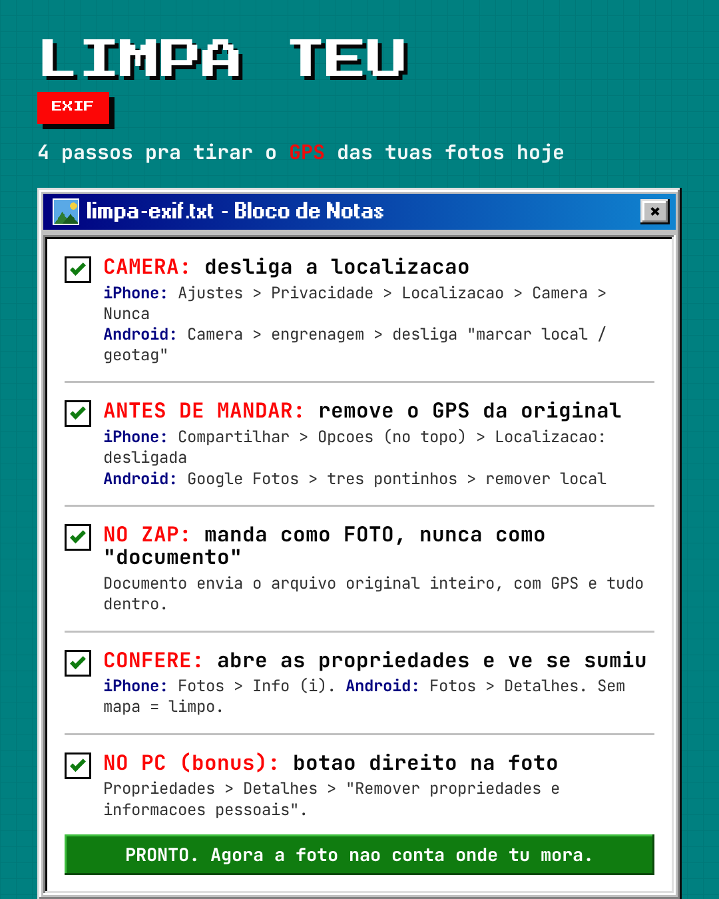

# foto-limpa

**Toda foto que teu celular tira pode guardar a tua localização (GPS) escondida dentro do
arquivo. Aqui tu vê isso na prática e sai sabendo limpar.**

Lab educativo da [CHDEVSEC](https://chdevsec.com.br). O foco é **conscientização de
privacidade**: os metadados **EXIF** de uma foto podem conter latitude e longitude exatas de
onde ela foi tirada. Este repo mostra isso num arquivo de treino **nosso** (GPS plantado por
nós) e entrega o **checklist pra limpar as tuas fotos**.

## O que este repo É
- Um lab que **gera a própria foto** de treino, planta um GPS fake e mostra como um comando
  (`exiftool`) revela a localização.
- A prova de que a coordenada vai **dentro do arquivo**, não na imagem que tu vê.
- A **defesa**: como tirar o GPS antes de compartilhar, no celular e no PC.

## O que este repo NÃO é
- Não é ferramenta de stalking, OSINT contra pessoa, nem de ler metadados de foto de
  terceiro sem autorização. Tudo roda numa foto de treino **gerada aqui**. Ver [ETICA.md](ETICA.md).

## Mostra rápido (10 segundos)

```bash
cd lab
./demo.sh        # gera a foto de lab, planta o GPS, mostra o que vaza e depois limpa
```

Tu vai ver o `exiftool` cuspir **modelo do aparelho, data, hora e a coordenada GPS** da foto
de treino. Depois o script gera uma cópia **limpa** e mostra que o GPS sumiu.

Precisa do `exiftool` instalado:

```bash
# Debian/Ubuntu
sudo apt install libimage-exiftool-perl imagemagick
# Arch
sudo pacman -S perl-image-exiftool imagemagick
# macOS
brew install exiftool imagemagick
```

## Por que isso importa (não é paranoia)

- Um estudo da **Universidade de Delaware** varreu quase **200 mil** fotos online: até
  **1 em cada 4** das fotos "intactas" ainda carregava a localização GPS cravada
  (Friedland & Sommer, RAID 2015 — os mesmos que cunharam o termo **"cybercasing"**: usar o
  geotag de uma foto pra planejar um crime no mundo real).
- **Instagram e Facebook removem** o EXIF quando tu posta. O vazamento real é quando tu manda
  a foto **original**: WhatsApp como *documento*, e-mail, anúncio de venda, Google Drive,
  AirDrop. Aí o GPS vai junto, inteiro.

## A defesa

A imagem que tu vê não mostra o GPS. Ele viaja **escondido no arquivo**. Então:

👉 **Desliga a localização da câmera, remove o GPS antes de mandar a original, e não envia
foto importante como "documento".** Confere nas propriedades antes de compartilhar.

- Como limpar, passo a passo (celular + PC): [`defesa/README.md`](defesa/README.md)
- **Checklist pra aplicar hoje:** [`defesa/checklist.md`](defesa/checklist.md)

### Card rápido (salva ou imprime)



Baixa em [PNG](defesa/limpa-exif-card.png) ou [PDF](defesa/limpa-exif-card.pdf).

## Licença
MIT — ver [LICENSE](LICENSE). Feito pela CHDEVSEC pra ensino de segurança e privacidade na prática.
