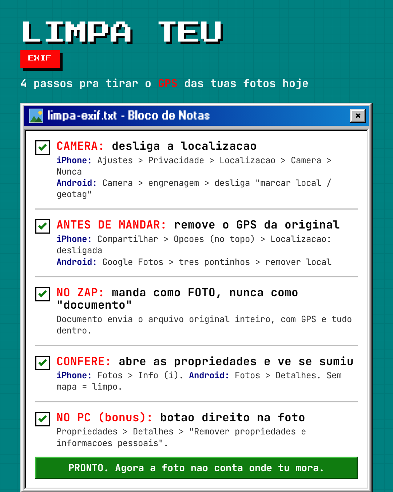

# Checklist: limpa teu EXIF (tira o GPS das tuas fotos)



> Prefere o card pra salvar ou imprimir? Baixa o [PDF](limpa-exif-card.pdf).

Marca cada um hoje. Leva 2 minutos.

## 1. Câmera: desliga a localização (para de gravar GPS novo)
- [ ] **iPhone:** Ajustes > Privacidade e Segurança > Serviços de Localização > Câmera > **Nunca**
- [ ] **Android:** app Câmera > ⚙ Configurações > desliga **"Marcar local" / "Geoetiquetas"**

## 2. Antes de mandar a original: remove o GPS
- [ ] **iPhone:** no app Fotos, botão Compartilhar > toque em **Opções** (no topo) > desliga **Localização**
- [ ] **Android:** Google Fotos > abre a foto > ⋮ > **Remover local** (ou Editar > remover geodados)
- [ ] **PC (Windows):** botão direito na foto > Propriedades > Detalhes > **"Remover propriedades e informações pessoais"**
- [ ] **PC/Linux/macOS:** `exiftool -all= foto.jpg` (remove todos os metadados)

## 3. No envio: cuidado com o canal
- [ ] No WhatsApp, manda como **Foto**, nunca como **Documento** (documento envia o arquivo original, com GPS)
- [ ] E-mail, Google Drive, AirDrop e Telegram "arquivo" **preservam** o EXIF — limpa antes
- [ ] Instagram e Facebook **removem** o EXIF no post, mas não confie: limpa na origem

## 4. Confere (confia desconfiando)
- [ ] **iPhone:** Fotos > abre a imagem > deslize pra cima ou toque em **ⓘ Info**. Sem mapa = limpo
- [ ] **Android:** Google Fotos > ⋮ ou deslize pra cima > **Detalhes**. Sem mapa = limpo
- [ ] **Linha de comando:** `exiftool -gps:all foto.jpg` tem que vir **vazio**

## Bônus: em lote
```bash
# limpa TODAS as fotos de uma pasta (gera cópia, mantém a original)
exiftool -all= -o limpas/ *.jpg
```

---
Feito pela [CHDEVSEC](https://chdevsec.com.br). Uso nas **suas próprias** fotos. Ver [../ETICA.md](../ETICA.md).
